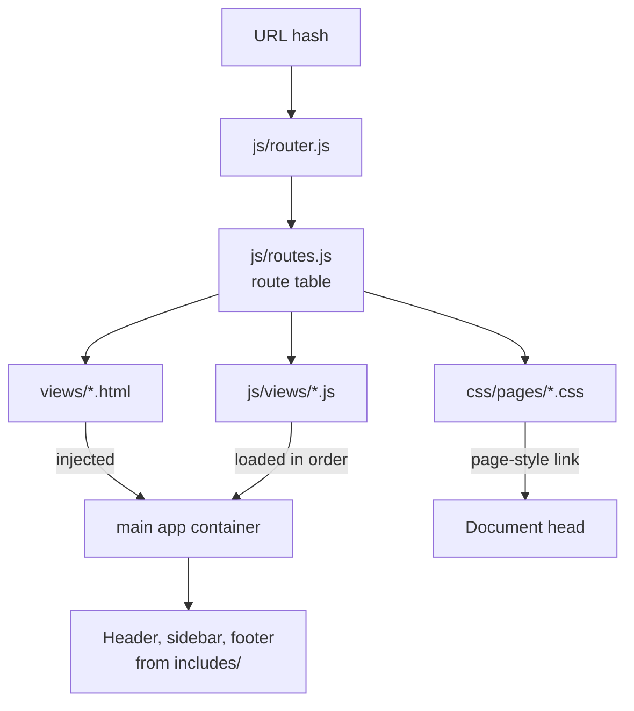
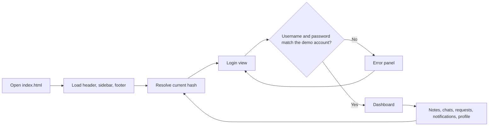

<div align="center">


<p><strong>A single-page student portal that covers grades, group chat, complaints, document requests, notifications, and a profile.</strong></p>

</div>

<div align="center">

<a href="https://github.com/mohammed-laabidi/site-scolaire"></a>
<a href="https://github.com/mohammed-laabidi/site-scolaire/fork"></a>
<a href="https://github.com/mohammed-laabidi/site-scolaire/issues"></a>


</div>

<div align="center">

<a href="https://mohammed-laabidi.github.io/site-scolaire/"><strong>Live Demo</strong></a>
&nbsp;&nbsp;|&nbsp;&nbsp;
<a href="https://github.com/mohammed-laabidi/site-scolaire">Repository</a>

</div>

## Overview

Site Scolaire is a front-end prototype of a student portal, written in plain HTML, CSS, and JavaScript without a framework or a build step. A small hash router swaps a page fragment into the document, loads the matching stylesheet, and injects the page script when the route changes. The header, sidebar, and footer are loaded once from the `includes/` folder and stay in place.

The portal covers nine routes: login with a forgot-password panel, a dashboard with summary cards and a progress bar, a grades page driven by a demo module list, a group chat, a complaint form, a document request form, a notifications page, and a profile page.

All data is demonstration data. The login check compares the submitted values against a fixed demo account, and the grades are defined in `js/views/grades.js`. There is no server, database, or session handling.

## Features

<table>
<tr>
<td width="50%" valign="top">


### Hash-based routing

`js/router.js` maps the URL fragment to an HTML view, a page stylesheet, and a list of page scripts, then injects them in order.

</td>
<td width="50%" valign="top">


### Persistent shell

Header, sidebar, and footer are loaded from `includes/` once, so navigation never reloads the shell.

</td>
</tr>
<tr>
<td width="50%" valign="top">


### Grades and averages

The notes page renders module tables with exam marks, averages, coefficients, and EFM results from a demo data module.

</td>
<td width="50%" valign="top">


### Group chat

A message input appends new bubbles to the conversation and scrolls to the latest entry.

</td>
</tr>
<tr>
<td width="50%" valign="top">


### Requests and complaints

Dedicated forms collect a complaint or a document request, including a conditional free-text field when Other is selected.

</td>
<td width="50%" valign="top">


### Responsive shell

Fifteen media queries adapt the layout, with an off-canvas sidebar on small screens and a fixed rail on desktop.

</td>
</tr>
</table>

## Technology Stack

<div align="center">


</div>

| Technology | Purpose |
| --- | --- |
| HTML5 | Shell document, page fragments in `views/`, and includes |
| CSS3 | Global shell styles plus one stylesheet per page |
| JavaScript | Hash router, include loader, and per-page logic |
| Font Awesome 6 | Icons loaded from a CDN |
| GitHub Pages | Static hosting of the live demo |

## Architecture

The application is a client-side shell with a router. Page HTML, CSS, and scripts are fetched on demand from the repository itself.



### Routes

| Route | View | Page stylesheet | Scripts |
| --- | --- | --- | --- |
| `#/` | `views/login.html` | `css/pages/login.css` | `js/views/login.js` |
| `#/login.html` | `views/login.html` | `css/pages/login.css` | `js/views/login.js` |
| `#/dashboard.html` | `views/dashboard.html` | `css/pages/dashboard.css` | none |
| `#/notes.html` | `views/notes.html` | `css/pages/notes.css` | `grades.js`, `notes.js` |
| `#/chats.html` | `views/chats.html` | `css/pages/chats.css` | `chats.js` |
| `#/reclamation.html` | `views/reclamation.html` | `css/pages/reclamation.css` | none |
| `#/document.html` | `views/document.html` | `css/pages/document.css` | `document.js` |
| `#/notifications.html` | `views/notifications.html` | `css/pages/notification.css` | none |
| `#/profile.html` | `views/profile.html` | `css/pages/profile.css` | none |

## Application Flow



The demo account is documented in the login view: username `stagaire` and password `stagaire123`. It exists only to demonstrate the redirect to the dashboard.

## Project Structure

```text
site-scolaire/
├── index.html
├── css/
│   ├── global.css
│   └── pages/
│       ├── chats.css
│       ├── dashboard.css
│       ├── document.css
│       ├── login.css
│       ├── notes.css
│       ├── notification.css
│       ├── profile.css
│       └── reclamation.css
├── img/
├── includes/
│   ├── footer.html
│   ├── header.html
│   └── sidebar.html
├── js/
│   ├── router.js
│   ├── routes.js
│   ├── utils.js
│   ├── shell/
│   │   ├── footer.js
│   │   ├── header.js
│   │   └── sidebar.js
│   └── views/
│       ├── chats.js
│       ├── document.js
│       ├── grades.js
│       ├── login.js
│       ├── notes.js
│       └── ...
├── views/
│   ├── chats.html
│   ├── dashboard.html
│   ├── document.html
│   ├── login.html
│   ├── notes.html
│   ├── notifications.html
│   ├── profile.html
│   └── reclamation.html
└── README.md
```

## Getting Started

### Prerequisites

A modern browser. The pages are fetched with `loadInclude`, so the project must be served over HTTP rather than opened as a local file.

### Installation

```bash
git clone https://github.com/mohammed-laabidi/site-scolaire.git
cd site-scolaire
python -m http.server 8000
```

Open `http://localhost:8000` and sign in with the demo account.

## Usage

1. Sign in on the login view, or open the forgot-password panel to review its layout.
2. Use the sidebar to move between dashboard, notes, chats, requests, notifications, and profile.
3. Review the module table on the notes page; the values are read from `js/views/grades.js`.
4. Send a message in the chat view; new bubbles are appended to the conversation.
5. Select Other in the document request form to reveal the free-text field.

## Notes

- The route table lives in `js/routes.js`; adding a page means adding a view, a stylesheet, a script, and a route entry.
- Demo data is limited to the login credentials and the module list in `js/views/grades.js`. No data is persisted between reloads.

## Deployment

The live demo is served by GitHub Pages from the repository root. Because all resources are relative, the same folder works on any static host.

## Author

<table>
<tr>
<td valign="top">

**Mohammed Laabidi**

<a href="https://github.com/mohammed-laabidi"> GitHub</a>
&nbsp;&nbsp;
<a href="https://www.linkedin.com/in/mohammed-laabidi-793a40436"> LinkedIn</a>
&nbsp;&nbsp;
<a href="mailto:mohammed-laabidi@gmail.com"> Email</a>

</td>
</tr>
</table>

---

If this project is useful to you, consider giving the repository a star.
